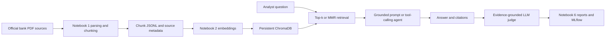

# System documentation

This project supports first-pass research over public filings from Canada's Big Five banks. It provides evidence-backed drafts, not automated compliance decisions. Current evaluation: `54a68bec798eab0e`; recommendation: iterate.

## Architecture and pipeline

Notebook 1 downloads maintained official PDF URLs, validates the content and records a manifest. It extracts PDF blocks, removes recognizable contents pages and recurring margin text, retains section/page metadata and creates token chunks with overlap. Heuristics cannot guarantee accurate multicolumn reading order or table structure; inspect flagged text. Notebook 2 stores local MiniLM or OpenAI embeddings with scalar bank/year/type/quarter/section metadata in Chroma. Current evaluation uses `local` embeddings and 10,196 indexed chunks across 44 filings. Keep the embedding preprocessing synchronized with its stored index; do not silently query a collection with a different model.

## Retrieval and prompts

Notebook 3 provides grounded answers with source labels. Notebook 4 compares basic, few-shot and evidence-checking prompts on 15 questions, validates structured source metadata and explores rewriting and edge cases. Prompt comparisons require human or explicitly automated ratings; a saved answer alone does not establish correctness. Step 6 uses exact step 4 prompt constants and fixed retrieval scopes for fair comparison. Structured output requires answer, sources (bank/document/section/year/label), confidence and caveats, with metadata checked against retrieved records.

Notebook 5 defines search_filings, get_filing_list and compare_sections with function schemas. Bank code BNS is canonical for Scotiabank; the tool accepts the name as an alias. It checks available filings, records tool arguments/observations and public action summaries, caps model iterations, and reports cost. An unavailable old filing prohibits asserting a risk is newly introduced. Source text can be incomplete; an absence in search results is not proof of absence in a report. The agent's self-directed searches may still miss relevant periods, and these failures must be evaluated rather than hidden.

## Evaluation and monitoring

Notebook 6 runs a 30-question set across three configurations and logs real usage and judge scores. See [evaluation_report.md](evaluation_report.md) for exact metrics, rubric, costs and limitations. Thresholds are faithfulness≥3.5 and relevance≥4.0; sample failures and missing manual reviews prevent a production recommendation even if an average passes. Inspect faithfulness≤2 cases, judge/rubric inconsistencies, unknown citations, missing years, tool errors, token spikes and incomplete answers. Check latency/cost distributions and compare production question mix with the test set. Add independently adjudicated ground truth and an analyst task-time study before claiming business savings.

## Operations and data handling

Use a local `.env` for OPENAI_API_KEY; never commit or print the value. Only public filing text is sent to the generation/judge API. Keep `data/raw`, processed source metadata, embedding settings and Chroma together for reproducibility. Case checkpoints, corpus/test/code hashes and raw usage enable audit and resumable runs. Generation and judge costs are separate. The API budget cap is estimated, not a billing guarantee. Install full MLflow to support the SQLite store and local UI. Do not rerun paid calls merely to display already-computed results.

Known data risks include incomplete BMO quarterly coverage, missing statutory filing dates, conservative English filtering and extracted tables. Stored section names are heuristic, not LLM-authored ground truth. Final human reviews and a measured time-savings study remain outstanding.
